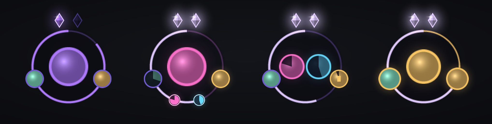
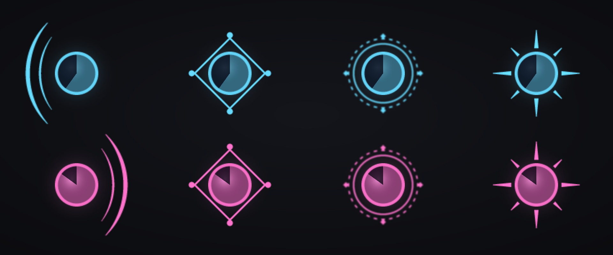

# Arcanum

Le HUD du mage Arcanes pour World of Warcraft: Forever : tes procs, tes charges et tes rappels, autour de ton personnage.

Arcanum place chaque information d'un côté de ton personnage, pour que tu la lises sans quitter le combat des yeux :

*Aperçu composé avec les textures de l'addon (le personnage est une silhouette, les icônes sont remplacées par des aplats, les zones sont plus rapprochées qu'en jeu). De gauche à droite : en combat avec deux procs et des charges, hors combat avec trois rappels, et la Présence spirituelle et Eurêka actifs. En jeu : `/arc demo`.*

- **À gauche : les Idées claires. À droite : le Barrage de projectiles.** Une grande icône, celle du proc, cerclée de sa couleur (bleu clair ou rose), avec le temps restant en chiffres et un voile qui grandit à mesure que le proc s'épuise. Pas de proc : le côté reste vide. Un **décor** entoure l'icône tant que le proc est là, à sa couleur : croissants (d'origine), losange, anneau de runes qui tourne, éclat de rayons, **art du jeu** (le grand arc gravé de runes peint par Blizzard pour l'alerte des Projectiles des Arcanes : violet pour le Barrage, teinté en bleu pour les Idées claires), ou aucun. Il se choisit dans les réglages (« Décor des procs », qui le montre aussitôt sur le HUD) ou avec `/arc decor`. À l'arrivée du proc, l'onde lumineuse est dans le même thème : un écho du décor, qui s'élargit et s'efface (un simple anneau si tu n'as choisi aucun décor).
- **En haut : les charges de Déflagration des Arcanes**, seulement quand tu en as. Un cristal par charge ; à quatre charges, le maximum, ils s'éclaircissent. Dessous, une barre se vide pendant les 18 secondes de la fenêtre des charges, avec les secondes restantes ; elle rougit quand la fenêtre va se fermer.
- **Au-dessus des charges : la Présence spirituelle et Eurêka**, tant qu'ils sont actifs. L'icône de la Présence spirituelle, cerclée de vert, te rappelle que ton prochain sort sera instantané ; celle d'Eurêka, cerclée d'or, montre son temps restant. Une seule active : elle est centrée ; les deux : côte à côte.
- **En bas, hors combat : les rappels.** L'icône de ce qu'il manque avant d'engager : Intelligence des Arcanes, armure, et ce qui reste à invoquer : eau, nourriture, gemme de mana. Seuls les objets invoqués comptent (une eau achetée ne dispense pas d'en invoquer), et pour la gemme c'est la meilleure que tu sais invoquer qui est attendue. Rien ne manque : rien ne s'affiche. Au repos en ville, les rappels attendent que tu sortes ou que tu cibles un ennemi.

*Les décors dessinés par Arcanum, de gauche à droite : croissants, losange, anneau de runes, éclat (le décor « art du jeu » utilise les images du jeu, absentes de cet aperçu). En haut sur des Idées claires, en bas sur un Barrage de projectiles.*

Le HUD est centré sur l'écran, là où se tient ton personnage. Le réglage « Écartement » (ou `/arc ecart 150`) éloigne ou rapproche les quatre zones ; `/arc verrou` permet de déplacer l'ensemble.

**Les sons.** Un son à l'arrivée d'un proc. Ce sont des sons du jeu : celui des Projectiles des Arcanes pour un Barrage de projectiles, celui du sort Idées claires pour des Idées claires. `/arc sons` les fait entendre.

Tu peux en choisir d'autres dans les réglages (`/arc`) : chaque signal a sa ligne, avec le nom du son entre deux flèches. Une flèche passe au son suivant et le fait entendre ; un clic sur le nom le rejoue. La liste propose une quinzaine de sons du jeu (alerte de raid, appel de préparation, montée de niveau, quête terminée, réveil…) et la **voix du jeu**, qui dit « Barrage » ou « Idées claires » avec la synthèse vocale de WoW, si une voix est installée sur ton ordinateur. Un son que ton client ne joue pas est sauté.

Pour un son hors liste : `/arc son 888` fait entendre le son de cet identifiant, `/arc son barrage 888` le choisit pour le Barrage (`clear` pour les Idées claires), `/arc son barrage` revient au son par défaut. Les identifiants se trouvent dans la base de sons de Wowhead (le nombre dans l'adresse de la page). Tu peux aussi déposer tes propres fichiers `.ogg` dans `Arcanum\Sounds` (voir le LISEZMOI du dossier).

**Ce qu'Arcanum ne fait plus.** Jusqu'à la version 0.12, Arcanum était un cercle qui conseillait le prochain sort. Depuis la 1.0 il ne conseille plus le cycle, et depuis la 1.1 il ne signale plus le moment du burst : il montre tes procs, tes charges, ta Présence spirituelle, ton Eurêka et tes rappels, et te laisse jouer.

## Installation

1. Télécharge `Arcanum-x.y.z-forever.zip` sur la dernière release du dépôt, ou récupère le dossier `Arcanum`.
2. Place le dossier `Arcanum` dans `World of Warcraft\_forever_\Interface\AddOns`.
3. Lance le jeu. Si Arcanum est marqué « périmé » dans la liste des addons, coche **Charger les addons périmés**.

Il ne se réveille que sur un mage. Après une mise à jour qui ajoute des textures, quitte et relance le jeu : un `/reload` ne les voit pas.

## Commandes

| Commande | Effet |
|---|---|
| `/arc` | Réglages (ce qui s'affiche, décor des procs, taille, écartement, sons) |
| `/arc demo` | Le HUD joue un cycle complet, sans combattre (marche sur toute classe) |
| `/arc verrou` | Déplacer le HUD, puis le fixer |
| `/arc taille 120` | Taille du HUD, en pourcentage (de 60 à 180) |
| `/arc ecart 150` | Distance entre le personnage et les zones (de 80 à 320) |
| `/arc decor` | Passe au décor de procs suivant ; `/arc decor runes` le choisit (`aucun`, `croissants`, `losange`, `runes`, `eclat`, `jeu`) |
| `/arc sons` | Fait entendre les deux sons (Idées claires, Barrage) |
| `/arc son 3071` | Fait entendre un son du jeu ; `/arc son barrage 3071` le choisit pour un proc (`clear` ou `barrage`), `/arc son barrage voix` le fait dire par la voix du jeu |
| `/arc macro` | Crée la macro de burst (Eureka + Présence spirituelle + Courroux) avec les noms exacts que le jeu donne aux sorts |
| `/arc diag` | Rapport à copier : sorts reconnus, signaux lus, derniers changements d'état |

**Comment il voit les procs en combat.** Forever cache les auras aux addons pendant le combat. Arcanum s'appuie sur ce qui reste lisible : tes propres sorts lancés (chaque Déflagration ajoute une charge, pendant les 18 s que dure la fenêtre ouverte par la première), le coût en mana annoncé par le jeu (Projectiles gratuits = Barrage, tout gratuit = Idées claires, et le coût de la Déflagration, +100 % par charge, donne le nombre exact de charges), la surbrillance des boutons, et les icônes du Gestionnaire de temps de recharge de Blizzard si tu y suis ces buffs (Options > Améliorations de jeu). Hors combat il relit les vraies auras et apprend les durées et les coûts réels. Il affiche, il ne lance rien.

## Développement

- `python tools/test/run_tests.py` lance un mage simulé avec les règles de Forever : auras cachées et valeurs secrètes en combat, coût des sorts et sorts lancés lisibles. Il compte aussi les appels au jeu et les opérations d'affichage, pour que l'addon reste sobre. Il faut le module `lupa` (`pip install lupa`).
- `python tools/make_media.py` régénère les textures, `python tools/preview.py` l'aperçu `docs/apercu.png`.
- Publier une version : ajoute une section `## X.Y.Z` dans `CHANGELOG.md`, puis `python tools/release.py X.Y.Z`. Le script met le numéro à jour, lance les tests, crée l'étiquette `vX.Y.Z` et pousse ; GitHub Actions publie la release (`Arcanum-X.Y.Z-forever.zip` et `release.json` pour WowUp).
