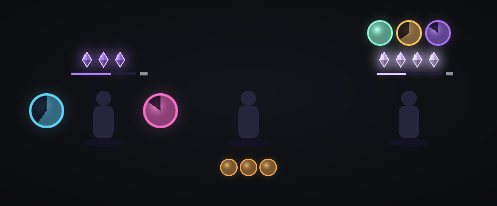

# Arcanum

An Arcane Mage HUD for World of Warcraft: Forever. It shows your procs, your Arcane Blast charges, your active buffs and your pre-combat reminders around your character, so you can read them without looking away from the fight.

*Preview built from the addon's own textures (the character is a silhouette, icons are flat colors, the zones sit closer together than in game, and the proc decoration, which is a game image, is not drawn). Left to right: in combat with two procs and charges, out of combat with three reminders, and active buffs above the charges. In game: `/arc demo`.*

## What it shows

- **Left: Clearcasting. Right: Missile Barrage.** A large icon of the proc, ringed in its color (light blue or pink), with the time left as a number and a swipe that grows as the proc runs out. No proc, nothing on that side. While the proc is up, a **decoration** frames the icon on its outer side: the big rune-engraved arc Blizzard painted for the Arcane Missiles proc alert, purple for Missile Barrage and tinted blue for Clearcasting. When the proc fires, the light wave is an echo of that arc that expands and fades. The "Proc decoration" setting (or `/arc decor`) hides it; the wave is then a plain ring.
- **Above: Arcane Blast charges**, only while you have some. One crystal per charge; at four charges, the maximum, they brighten. Below them, a bar empties over the 18 seconds of the charge window, with the seconds left; it turns red when the window is about to close.
- **Above the charges: your active buffs.** Presence of Mind, ringed in green, reminds you that your next spell is instant; Eureka, ringed in gold, and Arcane Power, ringed in purple, show their time left. One active: centered; several: side by side.
- **Below, out of combat: reminders.** The icon of whatever is missing before you pull: Arcane Intellect, your armor, and what is left to conjure: water, food, mana gem. Only conjured items count (bought water does not excuse you from conjuring), and for the gem it is the best one you can conjure that is expected. Nothing missing, nothing shown. While resting in a city, reminders wait until you leave or target an enemy.

The HUD is centered on the screen, where your character stands. The "Spread" setting (or `/arc spread 150`) moves the four zones closer or further; `/arc lock` lets you drag the whole thing.

Arcanum only displays. It does not advise a rotation and never casts anything.

## Sounds

A sound plays when a proc fires. They are game sounds: the Arcane Missiles sound for Missile Barrage, the Clearcasting spell sound for Clearcasting. `/arc sounds` plays them.

You can pick others in the settings (`/arc`): each proc has its row, with the sound's name between two arrows. An arrow moves to the next sound and plays it; clicking the name replays it. The list offers about fifteen game sounds (raid warning, ready check, level up, quest complete, alarm clock…) and the **game voice**, which says "Missile Barrage" or "Clearcasting" with WoW's text-to-speech, if a voice is installed on your computer. A sound your client cannot play is skipped.

For a sound that is not in the list: `/arc sound 888` plays the sound with that id, `/arc sound barrage 888` picks it for Missile Barrage (`clear` for Clearcasting), `/arc sound barrage` goes back to the default. Ids can be found in Wowhead's sound database (the number in the page address). You can also drop your own `.ogg` files in `Arcanum\Sounds` (see the README in that folder).

## Languages

Arcanum follows your game client's language. English is built in and French is fully translated; other clients show English. Spell names always come from the game itself, so procs and reminders work in every language.

Commands are English, and the French ones still work (`/arc verrou`, `/arc taille`, `/arc ecart`, `/arc sons`, `/arc son`).

## Installation

1. Download `Arcanum-x.y.z-forever.zip` from the latest release, or grab the `Arcanum` folder.
2. Put the `Arcanum` folder in `World of Warcraft\_forever_\Interface\AddOns`.
3. Start the game. If Arcanum is flagged "out of date" in the addon list, tick **Load out of date AddOns**.

With WowUp, add the repository URL (`https://github.com/NansMM/Arcanum`) under *Get Addons > Install from URL*.

Arcanum only wakes up on a mage. After an update that adds files, quit and restart the game: a `/reload` does not see them.

## Commands

| Command | Effect |
|---|---|
| `/arc` | Settings (what is shown, size, spread, sounds). The same settings are in the game's Options > AddOns list |
| `/arc demo` | The HUD plays a full cycle without fighting (works on any class) |
| `/arc lock` | Move the HUD, then lock it in place |
| `/arc scale 120` | HUD size, in percent (60 to 180) |
| `/arc spread 150` | Distance between your character and the zones (80 to 320) |
| `/arc decor` | Show or hide the proc decoration (the rune arcs) |
| `/arc sounds` | Play both sounds (Clearcasting, Missile Barrage) |
| `/arc sound 3071` | Play a game sound; `/arc sound barrage 3071` picks it for a proc (`clear` or `barrage`), `/arc sound barrage voice` has the game voice say it |
| `/arc macro` | Create the burst macro (Eureka + Presence of Mind + Arcane Wrath) with the exact names the game gives the spells |
| `/arc diag` | A report to copy: spells found, signals read, latest state changes |
| `/arc reset` | Restore the default settings |

## How it sees procs in combat

Forever hides auras from addons during combat. Arcanum relies on what stays readable:

- **your own casts**: each Arcane Blast adds a charge, during the 18 seconds of the window opened by the first one;
- **the mana cost the game announces**: free Arcane Missiles means Missile Barrage, everything free means Clearcasting, and the cost of Arcane Blast (+100 % per charge) gives the exact number of charges;
- **the glow on action buttons**;
- **Blizzard's Cooldown Manager icons**, if you track those buffs there (Options > Gameplay Enhancements).

Out of combat it reads the real auras again and learns the actual durations and costs.

## Development

- `python tools/test/run_tests.py` runs a simulated mage under Forever's rules: hidden auras and secret values in combat, readable spell costs and casts. It needs the `lupa` module (`pip install lupa`).
- `python tools/make_media.py` regenerates the textures, `python tools/preview.py` the preview `docs/preview.png`.
- Releasing: add a `## X.Y.Z` section to `CHANGELOG.md`, then `python tools/release.py X.Y.Z`. The script bumps the version, runs the tests, creates the `vX.Y.Z` tag and pushes; GitHub Actions publishes the release (`Arcanum-X.Y.Z-forever.zip` and `release.json` for WowUp).
- Adding a language: copy `Arcanum/Locales/frFR.lua`, change the locale code, translate the right-hand sides, and add the file to `Arcanum/Arcanum.toc`.
